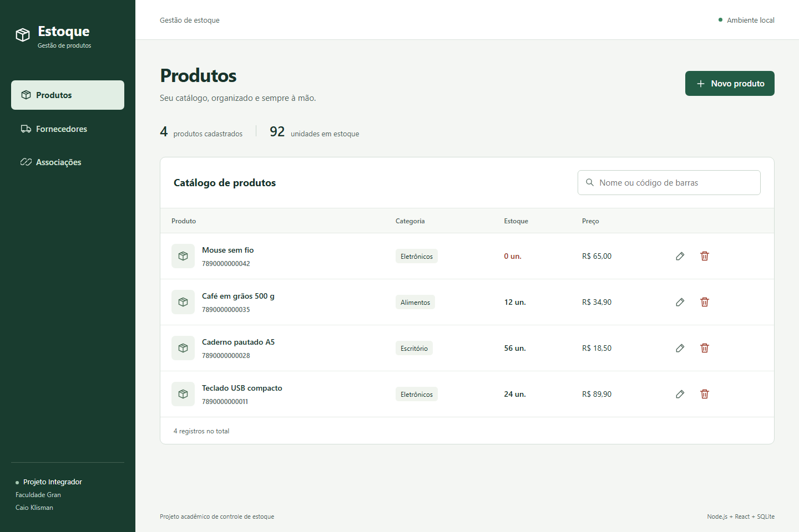

# FACULDADE GRAN

Projeto Disciplina Projeto Integrador

## Estoque — produtos e fornecedores

Aplicação fullstack de **Caio Klisman**, estudante de Análise e Desenvolvimento de Sistemas. Desenvolvida com apoio do Codex a partir das histórias de usuário da disciplina, para praticar API REST, persistência relacional e interfaces React.

O sistema permite cadastrar, pesquisar, consultar, editar e excluir produtos e fornecedores; associar vários fornecedores ao mesmo produto e consultar os vínculos nos dois sentidos. Valida dados e recusa códigos de barras, CNPJs e associações duplicados. Imagens opcionais são decodificadas e convertidas em WebP no servidor.



As capturas são do aplicativo funcionando localmente, com **dados fictícios de demonstração**. [Fornecedores](docs/images/fornecedores.png), [associações](docs/images/associacoes.png) e [celular](docs/images/celular.png).

## Executar

Requisitos: **Node.js 24.x**, npm e Git. O SQLite usa o módulo `node:sqlite` incluído no Node; não é necessário instalar um servidor de banco de dados.

```sh
git clone https://github.com/CKlisman/gran-estoque-fullstack.git
cd gran-estoque-fullstack
npm ci
npm run build
npm start
```

Abra **http://127.0.0.1:4316**. O banco vazio é criado automaticamente em `backend/data/estoque.db`.

Para inserir a demonstração, execute `npm run seed` antes ou depois de iniciar o servidor. Esse comando só insere dados se o banco estiver vazio; não apaga nem substitui seus cadastros. Os nomes, contatos e produtos de demonstração são inventados; os números usados são exemplos de teste.

Para desenvolver, use `npm run dev`: API na porta 4316 e React em **http://127.0.0.1:5174**, com proxy para a API. Encerre com Ctrl+C. Se uma porta estiver ocupada, feche a instância anterior. `PORT`, `DB_PATH` e `UPLOAD_DIR` são variáveis opcionais do backend; se alterar a porta da API em desenvolvimento, ajuste também o proxy em `frontend/vite.config.js`.

## Como usar

1. Em **Fornecedores**, cadastre empresa, CNPJ numérico válido, endereço e contatos.
2. Em **Produtos**, cadastre nome, descrição e categoria. Quantidade inicia em zero; código de barras, validade e imagem são opcionais. Preço representa o preço do produto, sem campo separado de custo.
3. Em **Associações**, selecione um produto e um fornecedor e clique em **Associar Fornecedor**. A aba **Por fornecedor** faz a consulta inversa.
4. Clique no nome na lista para ver detalhes. Use as ações de editar ou excluir; a exclusão pede confirmação e informa quantos vínculos serão removidos.

## Tecnologias e estrutura

Node.js, Express, SQLite, React, Vite, Multer e Sharp. Testes com Node Test Runner, Supertest e Playwright. Dependências resolvidas estão no `package-lock.json`.

```text
backend/app.js                 inicialização do servidor local
backend/src/app.js             aplicação HTTP e tratamento de erros
backend/src/controllers/       produtos, fornecedores e associações
backend/src/db/index.js        conexão e schema SQLite
backend/src/validation.js      regras dos campos
backend/test/                  testes HTTP com banco temporário
frontend/src/                  interface, formulários e cliente HTTP
e2e/                          fluxos de navegador e capturas
docs/                         desenho, plano, API e imagens
```

Produtos e fornecedores se relacionam por uma tabela intermediária com chave composta única. Chaves estrangeiras removem apenas vínculos ao excluir cadastros. Consultas usam parâmetros; dinheiro é armazenado em centavos. Cada aplicação de teste utiliza um banco separado do banco local normal.

## API e Postman/Insomnia

Importe [a coleção Postman](docs/estoque.postman_collection.json). Ela contém exemplos com dados fictícios e variáveis `baseUrl`, `productId` e `supplierId`. Os IDs são preenchidos pelas respostas de criação no Postman; no Insomnia, se os scripts de importação não forem executados, informe os IDs manualmente. [Contrato das rotas](docs/API.md).

## Verificar

### Novidade da Fase 3: relatórios de estoque

Foram adicionados dois endpoints de leitura, relacionados à necessidade de analisar e exportar dados levantada no estudo da AGEFIS:

- `GET /api/reports/stock-summary`: indicadores e totalização por categoria em JSON.
- `GET /api/reports/stock.csv`: exportação CSV compatível com planilhas, com os mesmos filtros.

[Duas chamadas para avaliação](docs/FASE_3_CHAMADAS.txt). [Filtros e contrato completo](docs/API.md#fase-3--duas-novas-chamadas-de-relatórios). Nenhuma integração foi feita com o SGA oficial; são funcionalidades novas deste protótipo acadêmico.

### Comandos de verificação

```sh
npm test
npm run build
npx playwright install chromium
npm run test:e2e
```

Os testes HTTP cobrem CRUD, validações, duplicidade, consultas nos dois sentidos, exclusão de vínculos, persistência, imagens e texto SQL como dado. Os testes de navegador cobrem o fluxo principal, falha de rede com preservação dos campos, uso de Escape/foco e largura de celular. O teste de apresentação atualiza as capturas em `docs/images` usando seu banco próprio.

## Escopo e limites

Projeto acadêmico **sem login**. Por padrão, o servidor escuta em `127.0.0.1`; para a demonstração pública no Render, `render.yaml` define `HOST=0.0.0.0`. Use somente dados fictícios nessa instância. O serviço gratuito suspende após inatividade e seu disco é temporário: cadastros e imagens enviados pela demonstração podem desaparecer ao suspender, reiniciar ou publicar novamente. O banco local, uploads, `.env` e dependências ficam fora do repositório.

O exercício usa CNPJ **numérico** de 14 dígitos, conforme o protótipo da disciplina. Não contempla CNPJ alfanumérico. A interface trata preço em reais e quantidades inteiras; não implementa histórico de entradas/saídas, vendas, faturamento, paginação ou controle de usuários. Imagens aceitas: PNG, JPEG e WebP, até 2 MB e 20 milhões de pixels. A exclusão de imagem é definitiva no armazenamento local.

Vite foi usado para inicializar React em lugar do comando Create React App apresentado no material. As três páginas continuam em React e consomem o backend Node como solicitado.

## Referências

- Material da disciplina Projeto Integrador, Faculdade Gran: histórias de usuário e etapas de preparação/backend/frontend fornecidas pelo aluno.
- [Node.js 24 — SQLite](https://nodejs.org/docs/latest-v24.x/api/sqlite.html)
- [Express](https://expressjs.com/en/starter/installing/)
- [React](https://react.dev/learn)
- [Vite](https://vite.dev/guide/)
